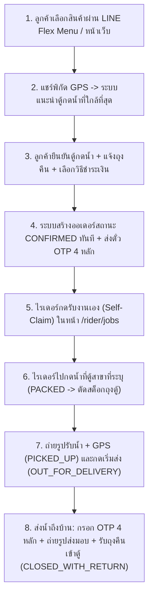

# 📖 คู่มือการฝึกอบรมและฐานความรู้ระบบ Drink&Go Delivery (Training Guide & KM)

คู่มือฉบับนี้จัดทำขึ้นเพื่อใช้ฝึกอบรม **ลูกค้า (Customer)**, **พนักงานจัดส่ง/ไรเดอร์ (Rider)** และ **ผู้ดูแลระบบ (Admin)** ในการใช้งานระบบสั่งน้ำดื่มและจัดส่งถึงบ้านผ่าน LINE OA (`@157iywjs`) และระบบเว็บ `idrink.tamadee.online`

---

## 📌 สารบัญ (Table of Contents)
1. [ภาพรวมของระบบและบทบาทผู้ใช้งาน (System Overview & Roles)](#1-ภาพรวมของระบบและบทบาทผู้ใช้งาน-system-overview--roles)
2. [ขั้นตอนการทำงานสำหรับลูกค้า (Customer Flow)](#2-ขั้นตอนการทำงานสำหรับลูกค้า-customer-flow)
3. [ขั้นตอนการทำงานสำหรับไรเดอร์ (Direct Rider Flow - No Warehouse)](#3-ขั้นตอนการทำงานสำหรับไรเดอร์-direct-rider-flow---no-warehouse)
4. [คู่มือการบริหารจัดการสำหรับแอดมิน (Admin Console)](#4-คู่มือการบริหารจัดการสำหรับแอดมิน-admin-console)
5. [เครือข่ายตู้กดน้ำ 15 สาขาทั่วไทย (Water Stations Network)](#5-เครือข่ายตู้กดน้ำ-15-สาขาทั่วไทย-water-stations-network)
6. [การแก้ไขปัญหาเบื้องต้น (Troubleshooting Guide)](#6-การแก้ไขปัญหาเบื้องต้น-troubleshooting-guide)

---

## 1. ภาพรวมของระบบและบทบาทผู้ใช้งาน (System Overview & Roles)

ระบบ **Drink&Go Delivery** มีแกนหลักด้านความถูกต้องและตรวจสอบย้อนหลังได้ 3 ประการ:
1. **Direct Rider Order State Machine**: ทุกขั้นตอนของการสั่งซื้อ กดน้ำ รับน้ำ และส่งมอบ มีหลักฐานภาพถ่าย พิกัด GPS และรหัส OTP 4 หลักโดยไม่ต้องผ่านคลังสินค้า (Warehouse)
2. **Smart Nearest Water Station Suggestion**: คำนวณระยะทาง Haversine จากพิกัดบ้านลูกค้าเพื่อแนะนำตู้กดน้ำที่ใกล้ที่สุดจาก 15 สาขา
3. **Append-Only Bag Ledger**: บัญชีถุงค้างของลูกค้า (`bag_ledger`) และสต็อกถุงประจำตู้กดน้ำ (`station_bag_ledger`) คำนวณจากผลรวมรายการเดินสะพัด (`SUM(qty)`) เสมอ

---

## 2. ขั้นตอนการทำงานสำหรับลูกค้า (Customer Flow)

1. **เปิดเมนูสั่งน้ำ**: พิมพ์ `"เมนู"` หรือกดปุ่ม Rich Menu ใน LINE OA (`@157iywjs`) ระบบจะส่งการ์ดสินค้าแบบ Carousel พร้อมปุ่มเพิ่มลงตะกร้า (`+` / `-`)
2. **ระบุที่อยู่และแชร์พิกัด GPS**: กดยืนยันตะกร้า เลือกใช้ที่อยู่เดิมหรือกรอกที่อยู่ใหม่พร้อมกดแชร์โลเคชัน (GPS)
3. **ยืนยันตู้กดน้ำใกล้บ้าน**: ระบบแสดงตู้กดน้ำที่ใกล้ที่สุดพร้อมระยะทาง (กม.) ให้กดยืนยัน หรือเลือกเปลี่ยนสาขาได้ตามต้องการ
4. **แจ้งจำนวนถุงคืนและชำระเงิน**: เลือกจำนวนถุงเปล่าที่จะฝากคืนไรเดอร์ เลือกชำระผ่าน **PromptPay QR Code** (ส่งรูปสลิปในแชท LINE) หรือ **เงินสดปลายทาง (CASH)**
5. **รับน้ำด้วยรหัส OTP 4 หลัก**: แจ้งรหัส OTP 4 หลักที่ปรากฏบนตั๋วออเดอร์ให้ไรเดอร์เมื่อน้ำมาส่งถึงหน้าบ้าน

---

## 3. ขั้นตอนการทำงานสำหรับไรเดอร์ (Direct Rider Flow - No Warehouse)

1. **เข้าสู่ระบบไรเดอร์**: เปิดหน้าเว็บแล้วเข้าสู่ระบบด้วยรหัสไรเดอร์ (ค่าเริ่มต้นทดสอบ: `rider` / `rider1234`) หน้าจอจะแสดงเฉพาะมุมมองไรเดอร์เท่านั้น
2. **กดรับงาน (`🙋‍♂️ รับงานนี้`)**: ออเดอร์ใหม่ที่มีสถานะ `CONFIRMED` จะแสดงในคิวกลาง ไรเดอร์กดรับงานได้ด้วยตนเองทันที (`POST /orders/:id/claim`)
3. **เดินทางไปกดน้ำที่ตู้สาขา (`PACKED`)**: ดูชื่อตู้กดน้ำที่ลูกค้าเลือกไว้ กดปุ่มนำทาง Google Maps ไปยังตู้ เมื่อกดน้ำบรรจุถุงเสร็จให้กด **"กดน้ำเสร็จ"** ระบบจะหักสต็อกถุงประจำตู้นั้น (`DISPENSED_OUT`) อัตโนมัติ
4. **ถ่ายรูปรับน้ำขึ้นรถ (`PICKED_UP`) และเริ่มวิ่งส่ง (`OUT_FOR_DELIVERY`)**: ถ่ายรูปหลักฐานพร้อมพิกัด GPS แล้วกดเริ่มจัดส่ง ระบบจะแจ้งเตือนเข้า LINE ลูกค้าทันที
5. **ส่งมอบน้ำ + กรอก OTP + รับถุงคืน (`DELIVERED` / `CLOSED_WITH_RETURN`)**:
   - กรอกรหัส OTP 4 หลักที่ได้รับจากลูกค้า + ถ่ายรูปหลักฐานการส่งมอบ (POD)
   - หากรับถุงเปล่าคืนจากลูกค้า ให้ระบุจำนวนถุงและถ่ายรูปถุง ระบบจะหักยอดถุงค้างของลูกค้า บวกสต็อกถุงกลับเข้าตู้กดน้ำ (`RETURNED_IN`) และปิดงานเป็น `CLOSED_WITH_RETURN` ทันที

---

## 4. คู่มือการบริหารจัดการสำหรับแอดมิน (Admin Console)

แอดมินเข้าสู่ระบบที่ `/admin` (ค่าเริ่มต้นทดสอบ: `admin` / `admin1234`) โดยจะเห็นแถบสลับมุมมองทั้ง 3 บทบาท (`ลูกค้า`, `ไรเดอร์`, `แอดมิน`) และปุ่ม `🎓 คู่มือ`
- **👤 จัดการผู้ใช้ (CRUD)**: เพิ่ม/แก้ไข/ตั้งรหัสผ่าน/ระงับสิทธิ์ผู้ใช้ทุกบทบาท
- **🛒 สินค้า & LINE Menu**: เพิ่มสินค้า อัปโหลดรูปภาพ และกดซิงก์ LINE Rich Menu 4 ปุ่ม
- **🚰 ตู้กดน้ำ 15 สาขา**: ตรวจสอบยอดถุงคงเหลือประจำตู้ เติมสต็อกถุง (`RESTOCK_IN`) หรือปรับปรุงยอด (`ADJUST`)
- **🏠 สมาชิก & วงเงิน**: กำหนดวงเงินเครดิต (`creditLimitSatang`) และอัปเดตพิกัด GPS บ้านลูกค้า
- **🚨 ออเดอร์**: อนุมัติสลิปโอนเงิน (`verify-payment`), ปลดล็อก OTP กรณีกรอกผิดครบ 5 ครั้ง (`unlock-otp`), นัดส่งใหม่ (`reschedule`) และดู Audit Trail ย้อนหลัง

---

## 5. เครือข่ายตู้กดน้ำ 15 สาขาทั่วไทย (Water Stations Network)

| รหัสตู้ | ชื่อสาขา | โซน / จังหวัด | พิกัด GPS (`lat, lng`) |
|---|---|---|---|
| `ST-01` | ตู้กดน้ำสาขาสุขุมวิท 50 (จุดหลัก) | เขตคลองเตย กรุงเทพฯ | `13.7058, 100.6012` |
| `ST-02` | ตู้กดน้ำสาขาอ่อนนุช 17 | เขตสวนหลวง กรุงเทพฯ | `13.7135, 100.6105` |
| `ST-03` | **ตู้กดน้ำสาขารามอินทรา 57** | เขตบางเขน กรุงเทพฯ | `13.8512, 100.6415` |
| `ST-04` | **ตู้กดน้ำสาขาพุทธบูชา 34** | เขตทุ่งครุ กรุงเทพฯ | `13.6458, 100.4932` |
| `ST-05` | ตู้กดน้ำสาขาลาดพร้าว 71 | เขตลาดพร้าว กรุงเทพฯ | `13.8035, 100.6075` |
| `ST-06` | ตู้กดน้ำสาขารัชดาภิเษก-ห้วยขวาง | เขตห้วยขวาง กรุงเทพฯ | `13.7770, 100.5736` |
| `ST-07` | ตู้กดน้ำสาขาพหลโยธิน-จตุจักร | เขตจตุจักร กรุงเทพฯ | `13.8160, 100.5612` |
| `ST-08` | ตู้กดน้ำสาขาบางแค-เพชรเกษม | เขตบางแค กรุงเทพฯ | `13.7118, 100.4085` |
| `ST-09` | ตู้กดน้ำสาขาพระราม 2-ท่าข้าม | เขตบางขุนเทียน กรุงเทพฯ | `13.6615, 100.4430` |
| `ST-10` | ตู้กดน้ำสาขาลาดกระบัง-ร่มเกล้า | เขตลาดกระบัง กรุงเทพฯ | `13.7275, 100.7485` |
| `ST-11` | ตู้กดน้ำสาขาเชียงใหม่ (ภาคเหนือ) | อ.เมืองเชียงใหม่ จ.เชียงใหม่ | `18.7961, 98.9680` |
| `ST-12` | ตู้กดน้ำสาขาขอนแก่น (ภาคอีสาน) | อ.เมืองขอนแก่น จ.ขอนแก่น | `16.4322, 102.8236` |
| `ST-13` | ตู้กดน้ำสาขาชลบุรี-พัทยากลาง (ภาคตะวันออก) | อ.บางละมุง จ.ชลบุรี | `12.9236, 100.8825` |
| `ST-14` | ตู้กดน้ำสาขาสงขลา-หาดใหญ่ (ภาคใต้) | อ.หาดใหญ่ จ.สงขลา | `7.0086, 100.4747` |
| `ST-15` | ตู้กดน้ำสาขาพระนครศรีอยุธยา (ภาคกลาง) | อ.พระนครศรีอยุธยา จ.อยุธยา | `14.3532, 100.5684` |

---

## 6. การแก้ไขปัญหาเบื้องต้น (Troubleshooting Guide)

- **กรอกรหัส OTP ผิดครบ 5 ครั้งจนถูกล็อก (`OTP_LOCKED`)**: ให้แอดมินเข้าเมนู `🚨 ออเดอร์` แล้วกดปุ่ม `🔓 ปลดล็อก OTP`
- **ลูกค้าส่งสลิปโอนเงินใน LINE แล้วสถานะยังเป็น `PENDING_VERIFY`**: ให้แอดมินตรวจสอบยอดโอนแล้วกดปุ่ม `✓ อนุมัติสลิปโอนเงิน` ในหน้า `🚨 ออเดอร์`
- **ไรเดอร์อยู่ในพื้นที่อับสัญญาณอินเทอร์เน็ต**: แอปจะเก็บคำสั่งไว้ในคิวออฟไลน์ (`📡 รอซิงก์`) พร้อม `Idempotency-Key` เมื่อสัญญาณกลับมาให้กดปุ่ม **"ซิงก์ทันที"** โดยข้อมูลไม่ซ้ำซ้อน
